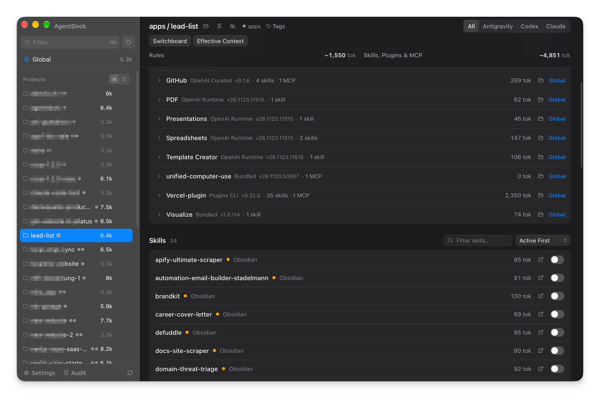
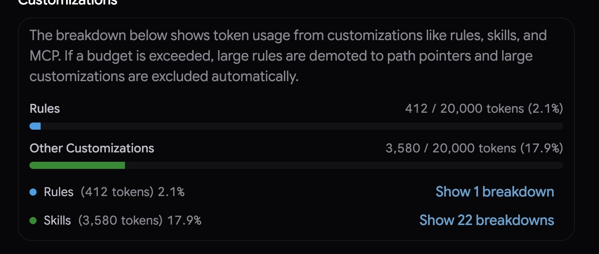

<div align="center">

# AgentDock

**A native macOS context switchboard for AI coding agents.**

Manage **Skills**, **MCP Servers**, **Rules**, **Plugins**, **Reusable Sets**, and **Support Docs** across **Google Antigravity**, **OpenAI Codex**, and **Claude Code** from one fast macOS window—with live startup token budgets and zero-copy symlinks.

[](https://github.com/petergus/agentdock/releases/latest)
[](https://github.com/petergus/agentdock/releases)
[](https://v2.tauri.app/)
[](LICENSE)

</div>

<br />



---

## Real-World Impact: Before & After

AI coding agents load rules, skills, subagents, and MCP tool schemas into their startup system prompt on every session. Without visibility, global directories silently accumulate dozens of unused skills and heavy MCP servers—burning through your 20,000-token customization budget before you type a single prompt.

In our own Antigravity setup, moving unmanaged global skills into an Obsidian-backed Library and toggling only what each project needs cut startup customization overhead by **75%** (**14,240 → 3,580 tokens**, saving **10,660 tokens** per session):

| Before AgentDock (`71.2%` budget used) | After AgentDock (`17.9%` budget used) |
| :---: | :---: |
|  |  |
| **83 Skills** (`11,460 tok`) · **3 Subagents** (`287 tok`) · **3 MCP Tools** (`2,493 tok`) = **14,240 / 20,000 tok** | **22 Skills** (`3,580 tok`) = **3,580 / 20,000 tok** |

---

## Contents

- [Download & Install](#download--install)
- [Core Philosophy](#core-philosophy)
- [Key Features](#key-features)
- [Supported Agent Paths](#supported-agent-paths)
- [Keyboard Shortcuts](#keyboard-shortcuts)
- [Safety & Git Hygiene](#safety--git-hygiene)
- [Development & Building from Source](#development--building-from-source)
- [License](#license)

---

## Download & Install

1. Download the latest `.dmg` from [**GitHub Releases**](https://github.com/petergus/agentdock/releases/latest).
2. Open the `.dmg` and drag **AgentDock.app** into **Applications**.

> [!NOTE]
> **Unsigned macOS build:** If macOS Gatekeeper warns that `AgentDock.app` is from an unidentified developer, right-click the app in Applications → **Open**, or run:
> ```bash
> xattr -cr /Applications/AgentDock.app
> ```

---

## Core Philosophy

AgentDock is intentionally a **switchboard, not an IDE**. There is no built-in Markdown editor, no menu-bar daemon, and no API proxy.

1. **Zero-Copy Single Source of Truth:** Keep your canonical skills and reusable rules in one or more Library folders (such as an **Obsidian vault** synced via iCloud or Dropbox). Flipping a switch **ON** creates a symlink; flipping it **OFF** removes only the symlink.
2. **Instant Token Visibility:** Every skill, rule, plugin, and MCP server is measured locally with `tiktoken-rs` (`cl100k_base`) so you see exact `Global + Project` startup overhead in real time.
3. **One Switchboard Across Three Agents:** Manage **Google Antigravity**, **OpenAI Codex**, and **Claude Code** side by side without duplicating files or fighting divergent config formats (`JSON`, `TOML`, `Markdown` frontmatter).

---

## Key Features

### Switchboard & Effective Context
- **Translucent macOS Vibrancy Sidebar:** Browse `Global` and all discovered or pinned projects with live per-project effective token totals (`Global + Project`), project tags, hide/pin controls, and `Reveal in Finder`.
- **Agent Filter Pills:** View `All`, `Antigravity`, `Codex`, or `Claude` in one click.
- **Effective Context View:** Switch from `Switchboard` to `Effective Context` to inspect the exact resolved context an agent sees for the selected scope.
- **Global Quick Switch:** Pause or restore global customizations cleanly without touching unmanaged directories.

### Skills & One-Click Global De-Bloat
- **Library Attribution:** Automatically tags skills by source (`Obsidian`, `Library`, `Global Only`, or `Broken Symlink`) and distinguishes upfront metadata tokens (`name + description`) from on-demand body tokens.
- **Global De-Bloat Banner:** Detects real (non-symlink) skill folders sitting directly inside global agent directories, previews the migration paths, and moves them safely into your Library as symlinks.
- **Cross-Agent Symlink Mirroring:** Enabling a project skill creates `.agents/skills/<name>` (shared by Antigravity and Codex) and optionally mirrors `.claude/skills/<name>` when Claude Code is enabled.

### MCP Catalog & Live Stdio Tool-Schema Probing
- **Central MCP Catalog:** Auto-imports servers discovered across Antigravity (`mcp_config.json`), Codex (`config.toml`), and Claude Code (`~/.claude.json` / `.mcp.json`), plus a `+ Add MCP` sheet for `stdio` and `http` servers.
- **Exact Tool-Schema Token Probing:** Click **Probe** on any `stdio` MCP server to spawn it with a 5-second timeout, run JSON-RPC `initialize` + `tools/list`, count the exact returned tool-schema tokens with `tiktoken-rs`, and cache the result.
- **Global Collision Guard:** Clearly marks project MCP rows as `Global` when already active globally.

### Rules & Zero-Token Support Docs
- **Rule & Frontmatter Management:** Inspect `AGENTS.md`, `GEMINI.md`, `CLAUDE.md`, and `.agents/rules/*.md`, and switch rule trigger modes (`always_on`, `model_decision`, `glob`) safely while preserving custom YAML keys and Markdown content.
- **Support Docs (Project Scope):** Attach reference folders or files either as a **Zero-Token Rule Pointer** (a managed block inside `AGENTS.md`) or as a **Local Reference Symlink** (`_support-docs/`, automatically excluded from Git).

### Reusable Sets, Plugins & Cleanup Audit
- **Reusable Sets:** Save working combinations of skills, MCP servers, and rules as named Sets, preview diffs before applying, and repair **Partial** sets by restoring missing items.
- **Plugins Management:** Inspect and toggle Antigravity, Codex, and Claude plugins with skill/MCP counts and token breakdowns.
- **Cleanup Audit:** Scan for and safely fix broken symlinks, duplicate entries, stale Codex plugin caches, stale `.git/info/exclude` entries, and instruction formatting issues.

---

## Supported Agent Paths

| Agent | Global Paths | Project Paths |
| :--- | :--- | :--- |
| **Google Antigravity** | `~/.gemini/AGENTS.md`, `~/.gemini/GEMINI.md`<br>`~/.gemini/config/rules/*.md`<br>`~/.gemini/config/skills/`<br>`~/.gemini/config/mcp_config.json` | `AGENTS.md`, `GEMINI.md`<br>`.agents/rules/*.md`<br>`.agents/skills/`<br>`.agents/mcp_config.json` |
| **OpenAI Codex** | `~/.codex/AGENTS.md`<br>`~/.agents/skills/`<br>`~/.codex/config.toml` (`[mcp_servers.<name>]`) | `AGENTS.md`<br>`.agents/skills/`<br>`.codex/config.toml` (`[mcp_servers.<name>]`) |
| **Claude Code** | `~/.claude/CLAUDE.md`<br>`~/.claude/skills/`<br>`~/.claude.json` | `CLAUDE.md`, `.claude/rules/*.md`<br>`.claude/skills/`<br>`.mcp.json` |

---

## Keyboard Shortcuts

| Shortcut | Action |
| :--- | :--- |
| `⌘K` | Focus Quick Filter (jump to any project or filter items) |
| `⌘,` | Open Settings |
| `⌘R` | Refresh Workspace |

---

## Safety & Git Hygiene

- **Never deletes real files on toggle-off:** Toggle-off only removes symlinks; unmanaged real directories are never deleted.
- **Format-preserving config writes:** Uses `toml_edit` for Codex `config.toml` and key-preserving updates for JSON configs so comments and unrelated settings stay intact.
- **Rolling backups:** Creates timestamped snapshots before modifying config files (retaining the latest 25).
- **Clean Git repos:** Optionally writes managed symlinks and local agent files to `.git/info/exclude` without ever touching `.gitignore`.

---

## Development & Building from Source

### Prerequisites

- **macOS 13.0+**
- **Node.js 20+** and **pnpm**
- **Rust 1.80+**

### Commands

```bash
# Install dependencies
pnpm install

# Start Vite + Tauri in development mode
pnpm tauri dev

# Typecheck and build frontend
pnpm build

# Run Rust backend unit tests
cargo test --manifest-path src-tauri/Cargo.toml

# Build macOS .app and .dmg bundle
pnpm tauri build
```

---

## License

MIT — see [LICENSE](LICENSE).
